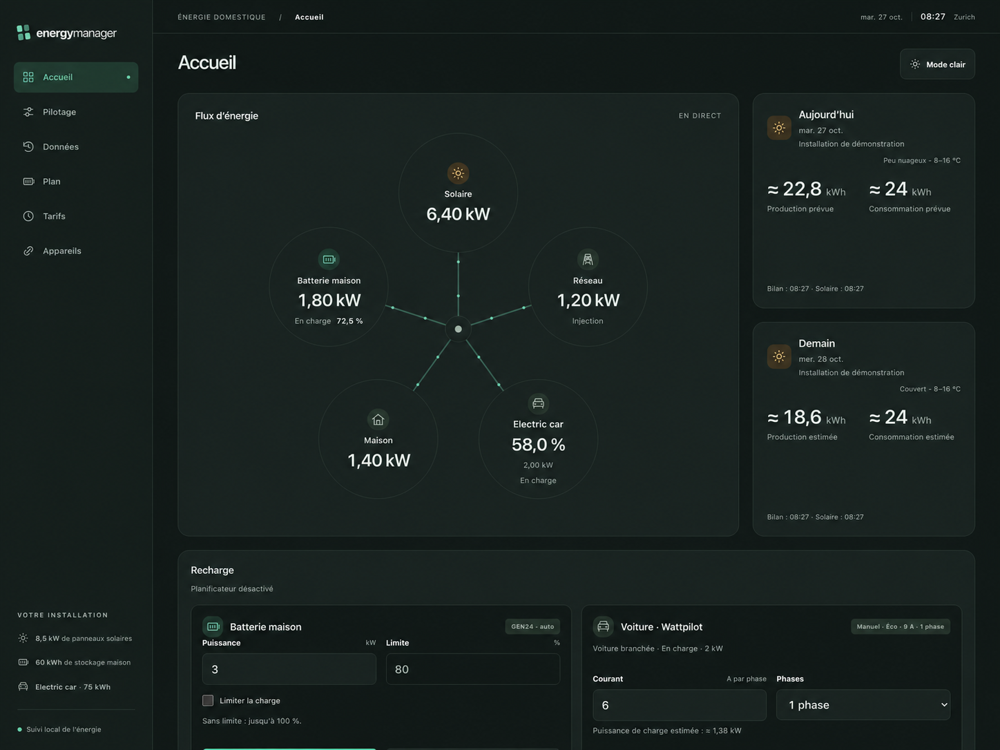

# Energy Manager

**A clearer picture of your home's energy—and a plan for what comes next.**

Your panels are producing, the battery is charging, the car is plugged in. But where is the energy going, and will there be enough when electricity gets expensive?

Energy Manager brings those questions into one local dashboard. It connects a Fronius GEN24 inverter, home battery and optional Wattpilot charger, combining live energy flows with solar forecasts, recorded history and tariff-aware charging plans.




## From a quick glance to a charging plan

- **Follow the energy.** An animated flow diagram connects solar, the grid, your home battery, the car and household demand. Live readings refresh every ten seconds; stale and missing values have distinct states.
- **Look ahead.** Today and tomorrow's solar forecasts sit beside household consumption estimates, weather and temperatures. Données shows production, consumption and battery forecasts in its daily chart and table, up to seven days ahead. Optional east–west roof settings account for panel orientation.
- **Compare predictions with reality.** Browse saved solar production, household consumption and battery state of charge by date, in quarter-hour or hourly views. Charts preserve gaps instead of inventing measurements.
- **Stay in control.** Set battery charging power and an optional SOC target, return to normal inverter operation, or select Wattpilot Normal, Eco or Pause with per-phase current limits.
- **Let charging follow your priorities.** Optional automation coordinates the home battery and car around low-tariff windows, solar availability, reserves and morning charge requirements. Manual actions pause automatic control.

The dashboard has six views: **Accueil** for the overview, **Pilotage** for controls, **Données** for recorded measurements and predictions, **Planification** for automatic decisions, **Tarifs** for charging windows, and **Appareils** for connections. It works on desktop and phones, with persistent light and dark themes.

## Built for a real installation

This is a self-hosted project built around a particular home, rather than a universal energy platform. Tariff rules, weekly car targets and parts of the interface reflect that installation. Review them before adapting it to yours.

| Component | Role |
| --- | --- |
| **Fronius GEN24 + home battery** | Live power and SOC through the Solar API; battery control through Modbus TCP |
| **Fronius Wattpilot** · optional | Local charger monitoring and control over WebSocket; classic models |
| **Tesla** · optional | Vehicle SOC through a personal Owner API refresh token, connected from Appareils |
| **Open-Meteo** · optional | Weather and solar forecast inputs for your configured location |
| **PostgreSQL 17** | Persistent observations and saved forecasts for the dashboard |

You can start with monitoring: device writes and battery automation are disabled in the example configuration. Tesla, Wattpilot and weather connections can be configured later. Local device communication stays on your network; weather forecasts and Tesla SOC use external services.

## Get it running

### 1. Install the prerequisites

Use **Node.js 26+**, **pnpm 10.10.0**, and **Docker Compose** for the supplied PostgreSQL service. If you use nvm, the repository's `.nvmrc` selects Node 26.

From the repository root:

```sh
nvm install
nvm use
pnpm install --frozen-lockfile
```

### 2. Create your configuration

On a fresh checkout:

```sh
cp services/energy-controller/.env.example services/energy-controller/.env
cp services/energy-orchestrator/.env.example services/energy-orchestrator/.env
```

Each service loads its own `.env`. Keep existing configuration files if you already have them.

Before starting:

- Set `FRONIUS_INVERTER_IP` in the controller's `.env` to your inverter's local address.
- Set `API_HOST=127.0.0.1` in the orchestrator's `.env` for access from this computer only. Its example file binds to `0.0.0.0`, which also allows access from other network interfaces.
- Keep the example `DATABASE_URL` for the supplied local database. Its port is **5434**, bound to loopback; the example password is for local development.
- To enable solar forecasts, set both `FORECAST_LATITUDE` and `FORECAST_LONGITUDE`, then review solar capacity, roof settings and household baseline for your installation. Leave both coordinates blank to keep forecasts disabled.

### 3. Start the database and services

```sh
docker compose up -d --wait postgres
pnpm dev:all
```

Open **[Energy Manager at localhost:3002](http://127.0.0.1:3002/)**. The device controller runs separately on port **3001**.

The orchestrator requires PostgreSQL at startup and creates its schema in an empty database. There is no JSON fallback, historical import or automatic schema migration. History has no automatic age-based deletion; back up the database and private service `data/` directories as part of operating the system.

For compiled execution, run `pnpm build`, then start `pnpm start:energy-controller` and `pnpm start:energy-orchestrator` in separate terminals. The supplied Compose file starts PostgreSQL only.

## How the pieces fit

```text
Browser → Energy Orchestrator → Energy Controller → GEN24 / home battery
                  │                    └──────────→ Wattpilot
                  ├── PostgreSQL
                  ├── Open-Meteo
                  └── Tesla Owner API
```

The **orchestrator** owns the dashboard, history, forecasts and energy policy. The **controller** owns device connections, command validation and control supervision. Keeping those responsibilities separate lets planning evolve while device limits remain enforced at the controller.

| Where to go | What you'll find |
| --- | --- |
| [Energy Orchestrator](services/energy-orchestrator/README.md) | Forecast configuration, Tesla connection, history, planning and dashboard APIs |
| [Energy Controller](services/energy-controller/README.md) | GEN24 and Wattpilot setup, control limits and device APIs |
| [Tariff and target policy](services/energy-orchestrator/src/policy.ts) | Current tariff calendar and weekly car targets |

## A few things to understand before enabling control

**Opt in deliberately.** GEN24 writes require `FRONIUS_CONTROL_ENABLED=true` and an appropriate power ceiling. Wattpilot writes have their own enable flag and current ceiling. Battery planning requires `AUTOMATION_ENABLED=true`; automatic car charging additionally requires selecting **Mode auto** in the dashboard. Follow the service guides for the complete setup.

**The current policy is specific.** Battery automation plans at quarter-hour intervals, charging at up to 6 kW within buffered low-tariff windows of 23:05–06:55 and 12:05–16:55. It yields to a 16 kW total-consumption ceiling. These are application constraints for the original installation, not a guarantee of electrical protection.

**Forecasts are estimates.** Household demand currently uses a configured constant baseline, excluding the car. Learned household profiles use verified measurements excluding car charging; house and car observations are stored separately using the Wattpilot charging meter, and measured solar is GEN24 PV DC, so comparisons need that context. Missing data remains unknown.

**Supervision has boundaries.** GEN24 control uses expiring inverter command leases. Wattpilot automation uses controller-owned software leases; a hardware expiry has not been verified, so cleanup depends on the controller remaining available.

**Keep deployment private.** These services are intended for a trusted local network. Put authentication and transport security in front of any remote access. Keep `.env` files, Tesla tokens and runtime state out of version control.

## Developing and contributing

The workspace uses TypeScript, Hono and a browser interface written in HTML, CSS and JavaScript. No frontend build framework is required.

```sh
pnpm dev:all                     # Run both services in development
pnpm build                       # Compile both services
pnpm typecheck                   # Check source, scripts and tests
pnpm test                        # Run service tests and cross-service integration tests
pnpm test:integration            # Run simulated planner/controller lifecycle tests
```

To work on one service, use `pnpm --filter energy-orchestrator <command>` or `pnpm --filter energy-controller <command>`. The root `pnpm dev` and `pnpm start` commands run the controller only. Compiled start commands watch build output; rebuild after source edits or use development mode.

Bug reports are most useful with the affected device, reproduction steps and sanitized logs. For control changes, describe the expected device behavior and include tests for failure and recovery paths.

## License

Energy Manager is licensed under the [MIT License](LICENSE). Third-party code and reference materials remain subject to their respective terms.
